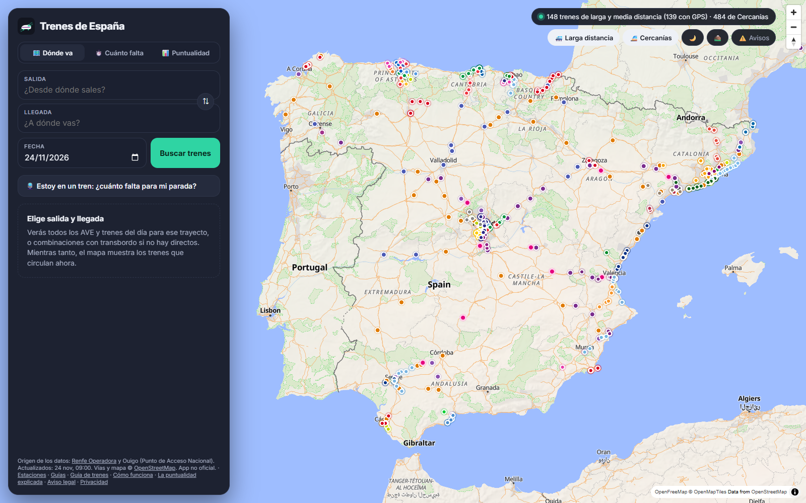
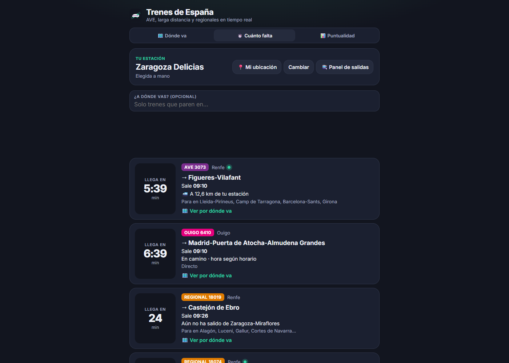
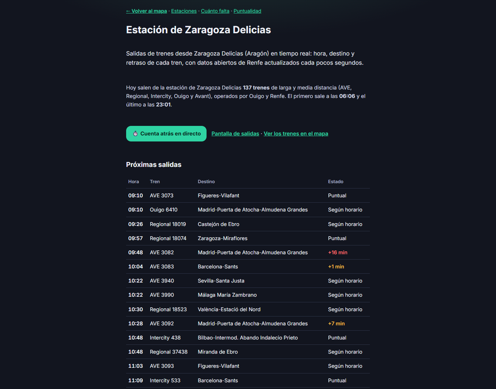
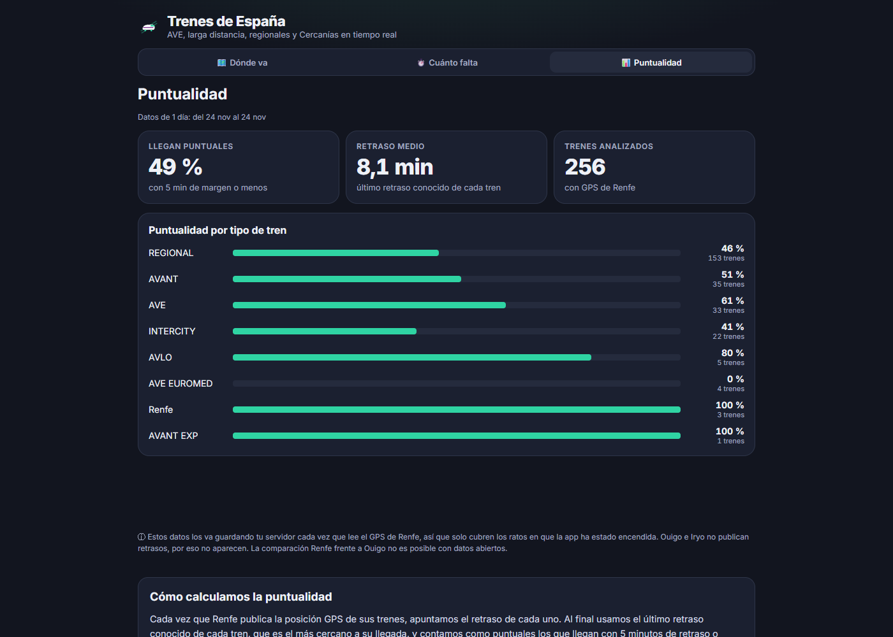
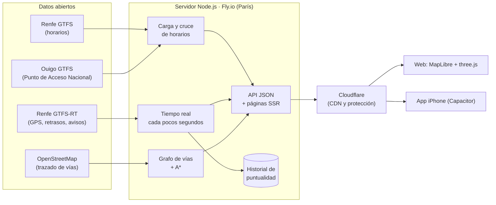

# 🚄 Trenes de España

**Mapa en tiempo real de todos los trenes de España**: AVE, larga y media distancia y Cercanías, con su posición GPS, su retraso y cuánto le falta a cada uno para llegar a tu estación.

🔗 **Web en producción: [trenesdeespana.es](https://trenesdeespana.es)**

Proyecto personal diseñado, programado, desplegado y mantenido por mí de principio a fin: servidor, frontend, mapa 3D, seguridad, SEO, despliegue y versión para iPhone.

> Este repositorio es un **escaparate**: explica el proyecto y muestra algunos fragmentos de código. El código completo es privado y **está disponible bajo petición** para procesos de selección.

---

## Qué hace

- **Mapa en directo** con unos 150 trenes de larga y media distancia y cerca de 500 Cercanías a la vez, cada uno colocado sobre la vía real y animado entre lecturas de GPS.
- **Buscador de trayectos**: todos los trenes del día entre dos estaciones, con combinaciones con transbordo cuando no hay directos.
- **«Cuánto falta»**: cuenta atrás de los próximos trenes de tu estación (por ubicación o elegida a mano), con su retraso y a cuántos kilómetros están.
- **Puntualidad**: estadísticas propias de retrasos por tipo de tren y trayecto, calculadas guardando el GPS de Renfe en el tiempo.
- **Una página por estación** generada en el servidor, con próximas salidas, destinos directos y primer y último tren del día.
- **Guías** escritas para viajeros (reclamaciones por retraso, cancelaciones, Cercanías…).
- **Panel de administración** con analítica propia anónima y usuarios activos en tiempo real.
- **Versión para iPhone** empaquetada con Capacitor.

| Cuánto falta | Página de estación | Puntualidad |
|---|---|---|
|  |  |  |

---

## Cómo funciona

1. **Horarios**: al arrancar, el servidor descarga y procesa los GTFS de Renfe y Ouigo (con un lector CSV/ZIP propio) y une las paradas de distintos operadores que son la misma estación.
2. **Tiempo real**: lee periódicamente el GTFS-RT de Renfe (posiciones GPS, retrasos, cancelaciones e incidencias) y lo cruza con los horarios.
3. **Recorridos sobre la vía real**: el trazado ferroviario de OpenStreetMap (unos 190.000 nodos) se guarda en memoria como un grafo compacto. Cada viaje se dibuja con una búsqueda **A\*** entre estaciones que prefiere el ancho de vía adecuado (alta velocidad o convencional).
4. **Posición del tren**: cada lectura de GPS se **proyecta** sobre ese recorrido; así se sabe cuántos metros lleva, cuánto le falta a cada estación y se puede animar suavemente en el mapa. Los trenes sin GPS público (Ouigo) se colocan según su horario.
5. **Frontend**: mapa vectorial con **MapLibre GL** y modelos 3D de los trenes con **three.js**, en módulos ES sin framework ni empaquetador.

---

## Retos técnicos que resolví

**Rendimiento con un solo servidor pequeño** (1 CPU compartida, 1 GB de RAM)
- Grafo de vías en arrays tipados (formato CSR) con índice espacial por rejilla: el trazado de un viaje se calcula en milisegundos y se guarda en caché por tramo.
- Caché de respuestas de pocos segundos que agrupa peticiones simultáneas iguales, y compresión gzip calculada una sola vez por respuesta.

**Seguridad** (revisada con mentalidad de pentesting antes de publicar)
- IP real del visitante verificada: solo se acepta la cabecera de Cloudflare si la conexión viene de verdad de un rango de Cloudflare.
- Límites de peticiones por IP, agrupando IPv6 por bloque /64 para que no baste con cambiar de dirección.
- Content-Security-Policy estricta, HSTS y cabeceras de seguridad (también en respuestas 304), límite de tamaño de cuerpo (413), tiempos máximos contra *slowloris*.
- Panel de administración con comparación de contraseña en tiempo constante y bloqueo tras intentos fallidos.
- Contenedor Docker ejecutándose sin privilegios de root.

**Privacidad y cumplimiento legal**
- Analítica propia sin cookies ni IPs guardadas: cada visitante se cuenta con una huella diaria que no permite identificarlo.
- Tipografía servida desde el propio servidor, aviso de cookies para la publicidad, atribuciones y licencias de datos (condiciones de Renfe, ODbL de OpenStreetMap).

**SEO**
- Páginas de estación renderizadas en el servidor con datos estructurados (`TrainStation`, `BreadcrumbList`), sitemap dinámico y contenido propio.

---

## Fragmentos de código

| Fichero | Qué muestra |
|---|---|
| [`fragmentos/ruta-por-las-vias.js`](fragmentos/ruta-por-las-vias.js) | A* con montículo binario propio sobre el grafo ferroviario, con varios orígenes y destinos y penalización por ancho de vía |
| [`fragmentos/posicion-sobre-la-via.js`](fragmentos/posicion-sobre-la-via.js) | Proyección de un punto GPS sobre el recorrido y búsqueda binaria del punto a X metros |
| [`fragmentos/ip-real-y-limites.js`](fragmentos/ip-real-y-limites.js) | IP real detrás de Fly.io y Cloudflare sin confiar en cabeceras falsificables, y límites por IP/bloque IPv6 |

---

## Tecnologías

**Servidor:** Node.js (módulo `http`, sin framework) · GTFS y GTFS-RT · Docker
**Frontend:** JavaScript (módulos ES) · MapLibre GL JS · three.js · HTML y CSS sin framework
**Infraestructura:** Fly.io · Cloudflare (DNS, CDN, protección) · GitHub
**Móvil:** Capacitor (iOS)
**Datos:** Renfe Data · Punto de Acceso Nacional de Transporte · OpenStreetMap

---

## Origen de los datos

Origen de los datos: Renfe Operadora y Punto de Acceso Nacional de Transporte Multimodal. Vías y mapa © colaboradores de OpenStreetMap. Trenes de España es un proyecto independiente y no está vinculado a Renfe, Adif, Ouigo ni Iryo.

## Licencia

© David Tella. **Todos los derechos reservados.** Este repositorio se publica solo para mostrar el proyecto; no se concede permiso para copiar, modificar ni reutilizar su contenido. Ver [LICENSE](LICENSE).
